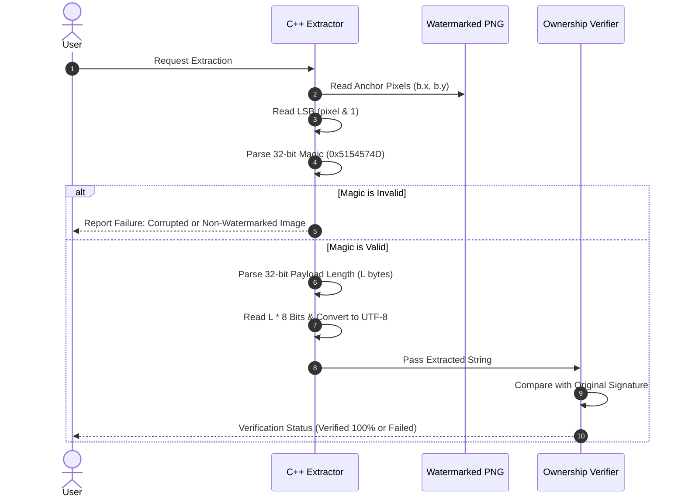

# Algorithms & Implementation Specification

## 1. QuadTree Divide & Conquer Decomposition

### 1.1 Algorithmic Pseudocode

```text
ALGORITHM QuadTreeDivide(image, x, y, size, min_block_size, threshold):
Input: 
  image: 2D Grayscale pixel matrix of dimension N x N
  x, y: Top-left coordinates of current block
  size: Current width/height of square block
  min_block_size: Minimum stopping dimension S (e.g., 16)
  threshold: Variance cutoff T (e.g., 100.0)

Output:
  leaf_blocks: Collection of all terminal blocks with computed statistics
  selected_blocks: Collection of blocks with variance >= threshold

BEGIN
    // Base Condition: Leaf level reached
    IF size <= min_block_size THEN
        var <- ComputeVariance(image, x, y, size)
        block <- CreateBlock(id, x, y, size, var)
        IF var >= threshold THEN
            block.selected <- TRUE
            selected_blocks.Append(block)
        ELSE
            block.selected <- FALSE
            rejected_blocks.Append(block)
        END IF
        leaf_blocks.Append(block)
        RETURN
    END IF

    // Divide Step: Halve dimensions into 4 equal quadrants
    half <- size / 2

    // Recursive Calls (Conquer)
    QuadTreeDivide(image, x,        y,        half, min_block_size, threshold) // NW
    QuadTreeDivide(image, x + half, y,        half, min_block_size, threshold) // NE
    QuadTreeDivide(image, x,        y + half, half, min_block_size, threshold) // SW
    QuadTreeDivide(image, x + half, y + half, half, min_block_size, threshold) // SE
END
```

---

## 2. Spatial Variance Texture Calculation

For an image block of size $S \times S$ starting at offset $(x, y)$:
Total number of pixels $N = S^2$.

### Mathematical Equations:

$$\mu = \frac{1}{N} \sum_{r=y}^{y+S-1} \sum_{c=x}^{x+S-1} I(r, c)$$

$$\sigma^2 = \frac{1}{N} \sum_{r=y}^{y+S-1} \sum_{c=x}^{x+S-1} \left( I(r, c) - \mu \right)^2$$

### C++ Implementation:
```cpp
double QuadTree::calculateVariance(const cv::Mat& image, int x, int y, int size) {
    int N = size * size;
    if (N == 0) return 0.0;

    double sum = 0.0;
    for (int r = y; r < y + size; ++r) {
        for (int c = x; c < x + size; ++c) {
            sum += static_cast<double>(image.at<uint8_t>(r, c));
        }
    }
    double mean = sum / N;

    double sqDiffSum = 0.0;
    for (int r = y; r < y + size; ++r) {
        for (int c = x; c < x + size; ++c) {
            double diff = static_cast<double>(image.at<uint8_t>(r, c)) - mean;
            sqDiffSum += diff * diff;
        }
    }
    return sqDiffSum / N;
}
```

---

## 3. Watermark Payload Protocol & LSB Embedding

### 3.1 64-Bit Protocol Header Structure

| Field Name | Bit Width | Hex Value | Description |
| :--- | :--- | :--- | :--- |
| **Magic Identifier** | 32 Bits | `0x5154574D` | ASCII `"QTWM"` (QuadTree WaterMark) for authenticity |
| **Message Length** | 32 Bits | Integer $L$ | Byte length of the UTF-8 payload message |
| **Payload Data** | $8 \times L$ Bits | Variable | Binary ASCII/UTF-8 representation of owner message |

**Total Required Capacity:**
$$\text{Required Bits} = 64 + 8 \times L$$

### 3.2 LSB Injection Operation

For each bit $b_k \in \{0, 1\}$ at index $k$ in the bitstream, the corresponding selected block $B_k$ (sorted by row-major order: $y$ coordinate first, then $x$) has its top-left anchor pixel $(B_k.x, B_k.y)$ modified as:

$$\text{pixel}_{\text{new}} = (\text{pixel}_{\text{old}} \ \& \ 11111110_2) \ | \ b_k$$

In C++:
```cpp
uint8_t originalVal = watermarkedImage.at<uint8_t>(by, bx);
uint8_t modifiedVal = (originalVal & 254) | bit;
watermarkedImage.at<uint8_t>(by, bx) = modifiedVal;
```

---

## 4. Watermark Blind Extraction & Verification



---

## 5. Image Fidelity & Distortion Metrics

### 5.1 Mean Squared Error (MSE)
$$\text{MSE} = \frac{1}{M \times N} \sum_{r=0}^{M-1} \sum_{c=0}^{N-1} [ I_{\text{orig}}(r, c) - I_{\text{watermarked}}(r, c) ]^2$$

### 5.2 Peak Signal-to-Noise Ratio (PSNR)
$$\text{PSNR} = 10 \times \log_{10} \left( \frac{255^2}{\text{MSE}} \right) \quad (\text{in decibels, dB})$$

- If $\text{MSE} = 0$, the images are identical and $\text{PSNR} = \infty$.
- For spatial 1-bit LSB embedding over sparse anchor pixels, typical PSNR values exceed **65 to 75 dB**, well above the Human Visual System threshold of **40 dB** (which represents imperceptibility).
