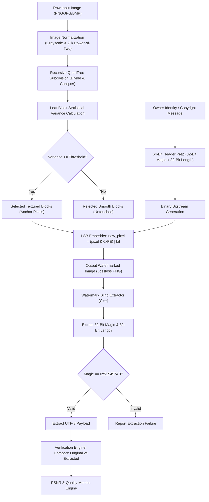

# QuadTree-Based Invisible Image Watermark Embedding Using Divide and Conquer

## Project Overview for Beginners & Viva Presentation

### 1. Introduction & Background
In the digital age, multimedia content such as digital photographs, medical images, artwork, and technical diagrams can be effortlessly copied, distributed, and claimed by unauthorized parties. Digital image watermarking is the practice of embedding hidden ownership markers, signatures, or metadata into digital media to assert legal ownership, prove provenance, and detect tampering.

Watermarks generally fall into two categories:
1. **Visible Watermarks:** Transparent logos or text superimposed on top of an image. While deterring casual copying, visible watermarks degrade image aesthetic appeal and can often be cropped out or removed by image inpainting algorithms.
2. **Invisible Watermarks:** Data imperceptibly woven into the image's mathematical pixel structures. The image appears completely indistinguishable from the original to the human observer, but a dedicated extraction algorithm can extract and verify the owner's cryptographic signature.

### 2. The Core Problem: Where Should Invisible Watermarks Be Placed?
Naive watermarking systems simply overwrite the least significant bits (LSBs) across sequential pixels starting from coordinate `(0, 0)`. However:
- **Smooth Regions Are Fragile to Noise:** The human eye is extraordinarily sensitive to subtle luminance changes in smooth, flat regions (such as clear blue skies or solid backgrounds). Modifying bits in smooth areas causes visible graininess and banding artifacts.
- **Textured Regions Provide HVS Masking:** The Human Visual System (HVS) possesses spatial masking characteristics. In areas with high spatial activity, intricate textures, dense foliage, and sharp edges, human observers cannot perceive minor $\pm 1$ level intensity variations.

**The Solution:** Use an algorithmic technique to identify and select *only* the high-frequency, high-variance textured blocks for watermark insertion, completely bypassing flat or smooth regions.

---

### 3. Why the QuadTree (Divide and Conquer) Algorithm?
A standard uniform grid divides an image blindly into static blocks. In contrast, the **QuadTree** is a hierarchical Divide and Conquer tree data structure:
1. It models 2D spatial locality naturally.
2. It allows recursive decomposition of a 2D bounding space into four equal quadrants:
   - **Top-Left (NW)**
   - **Top-Right (NE)**
   - **Bottom-Left (SW)**
   - **Bottom-Right (SE)**
3. The recursive division proceeds until reaching a configurable minimum leaf block size $S$ (e.g., $16 \times 16$ pixels).
4. At the leaf nodes, the local statistical variance is calculated.
5. If the variance meets or exceeds a defined threshold $T$, the block is classified as **Textured (Selected)**. Otherwise, it is classified as **Smooth (Rejected)**.

---

### 4. System Architecture

The following Mermaid diagram illustrates the architectural flow of the system:

---

### 5. Detailed Step-by-Step Workflow

#### Step 1: Input Ingestion & Normalization
The image is loaded into memory using the C++ backend. Because strict 4-way QuadTree decomposition requires equal recursive division at every step, the image dimensions are normalized to a square power-of-two (e.g., $256 \times 256$ or $512 \times 512$). The image is converted to grayscale to establish luminance values.

#### Step 2: Recursive QuadTree Decomposition
Starting at the root coordinate `(0, 0)` with width $N$, the algorithm recursively halves both dimensions, creating 4 child branches:
- Top-Left: `(x, y, N/2)`
- Top-Right: `(x + N/2, y, N/2)`
- Bottom-Left: `(x, y + N/2, N/2)`
- Bottom-Right: `(x + N/2, y + N/2, N/2)`

#### Step 3: Variance Calculation
When a subproblem reaches the leaf size $S$, recursion stops (base condition). The sample variance is calculated over all $S \times S$ pixels:
$$\text{Mean} = \frac{1}{S^2} \sum_{i=1}^{S^2} p_i, \quad \text{Variance} = \frac{1}{S^2} \sum_{i=1}^{S^2} (p_i - \text{Mean})^2$$

#### Step 4: Selective LSB Embedding
The watermark consists of:
1. **32-bit Magic Identifier:** `0x5154574D` ('Q','T','W','M').
2. **32-bit Payload Length:** Number of bytes in the message.
3. **Payload Bits:** The UTF-8 binary stream of the ownership string.

Each bit is embedded into the top-left anchor pixel `(x, y)` of the selected blocks sorted in deterministic row-major order:
$$\text{pixel}_{\text{new}} = (\text{pixel}_{\text{original}} \ \& \ 254) \ | \ \text{watermark\_bit}$$

#### Step 5: Blind Extraction & Verification
To extract the watermark:
1. The watermarked PNG is reloaded from disk.
2. The anchor pixels of the matching selected blocks are inspected in row-major order.
3. The LSB is read from each anchor (`pixel & 1`).
4. The first 32 bits are matched against `0x5154574D`.
5. The next 32 bits determine the message length $L$.
6. The subsequent $L \times 8$ bits are converted back into characters.
7. The extracted string is compared with the claimed owner signature to guarantee 100% bit-level integrity.
