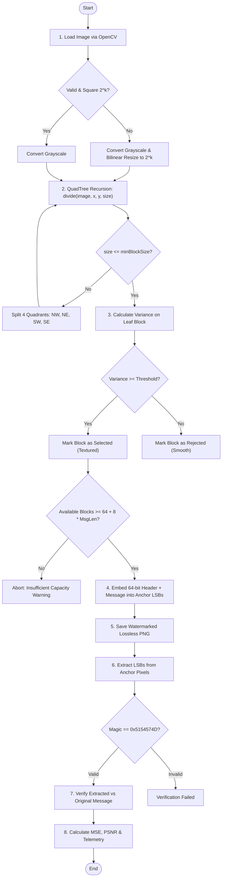

# DAA Viva Voce Preparation Guide (25+ Questions & Answers)

This document provides clear, concise, and academically rigorous answers to 28 questions frequently asked during mini-project viva evaluations.

---

## Architecture & Flowchart

---

## 28 Comprehensive Viva Questions & Model Answers

### Question 1: What is the main objective of this project?
**Answer:** The objective is to protect digital image ownership using invisible watermarking. The system employs a QuadTree-based Divide and Conquer algorithm to recursively decompose an image into quadrants, calculates spatial variance to identify textured regions, and embeds an ownership signature into anchor pixels using Least Significant Bit (LSB) encoding.

### Question 2: Why do you categorize this under "Design and Analysis of Algorithms (DAA)"?
**Answer:** Because the core spatial decomposition is a classic implementation of the **Divide and Conquer** paradigm using a recursive **QuadTree** data structure. The project demonstrates recursive tree branching, base case termination, recurrence relations, Master Theorem asymptotic analysis, and empirical timing evaluation.

### Question 3: What is a QuadTree and how does it work?
**Answer:** A QuadTree is a 4-ary tree data structure in which each internal node has exactly four children. In image processing, it recursively divides a two-dimensional space into four quadrants: North-West (Top-Left), North-East (Top-Right), South-West (Bottom-Left), and South-East (Bottom-Right).

### Question 4: What is the base condition in your QuadTree recursion?
**Answer:** Recursion halts when the current block dimension `size <= minimum_block_size` (configured to 8, 16, or 32 pixels). At this point, the block is deemed a leaf node, its variance is calculated, and it is categorized as selected or rejected.

### Question 5: Why is spatial variance used as a texture metric?
**Answer:** Spatial variance ($\sigma^2$) measures the dispersion of pixel intensity values around their local mean ($\mu$). A uniform, flat region has near-zero variance, while complex edges, detailed textures, and high-frequency patterns have high variance.

### Question 6: What is Human Visual System (HVS) masking?
**Answer:** HVS masking is a psycho-visual phenomenon where the human eye's ability to detect small artifacts or noise is reduced in regions containing high spatial activity or busy textures. By hiding watermark bits in high-variance textured regions, modifications remain completely imperceptible to human observers.

### Question 7: How does Least Significant Bit (LSB) embedding work?
**Answer:** An 8-bit grayscale pixel has values from 0 to 255. The 0th bit (LSB) represents a weight of $2^0 = 1$. LSB embedding performs a bitwise operation:
`new_pixel = (original_pixel & 254) | watermark_bit`. This modifies the pixel intensity by at most $\pm 1$, causing an imperceptible change.

### Question 8: Why is the image converted to grayscale?
**Answer:** Grayscale simplifies luminance processing to a single intensity channel (0-255 per pixel), enabling direct spatial variance computation and eliminating color-space chromatic aberration during 1-bit LSB substitution.

### Question 9: Why does the image dimension need to be a power of two?
**Answer:** Strict recursive 4-way QuadTree decomposition halves dimensions at each level ($N \to N/2 \to N/4 \dots$). A power-of-two square grid ($2^k \times 2^k$) ensures that divisions are always clean integer divisions without fractional pixel remainders.

### Question 10: How does your system handle non-power-of-two images?
**Answer:** The C++ backend inspects the input dimensions, computes the nearest power-of-two (e.g. 256 or 512), normalizes the image via bilinear interpolation, and notifies the user in the metadata log without modifying the original source file.

### Question 11: What is the structure of your watermark protocol header?
**Answer:** It uses a fixed 64-bit header:
1. 32-bit Magic Identifier (`0x5154574D` representing ASCII `'QTWM'`).
2. 32-bit integer representing the payload byte length.
This is immediately followed by the UTF-8 payload bits.

### Question 12: Why is a magic identifier necessary?
**Answer:** The magic identifier allows the extraction algorithm to verify whether an image actually contains a valid watermark created by this system, preventing extraction of garbage data from unwatermarked images.

### Question 13: How is deterministic extraction guaranteed?
**Answer:** The selected leaf blocks are ordered deterministically using row-major coordinate ordering ($y$ coordinate first, then $x$). The top-left pixel $(x, y)$ of each block serves as the invariant anchor.

### Question 14: What happens if there are fewer selected blocks than required bits?
**Answer:** The backend detects the condition `available_capacity < required_bits`, aborts the embedding safely without corrupting the image, and informs the user to either lower the variance threshold or decrease the minimum block size.

### Question 15: What is the recurrence relation for the QuadTree algorithm?
**Answer:**
$$T(n) = 4T(n/2) + o(n^2)$$
Where $a = 4$, $b = 2$, and $f(n) = O(1)$ at internal nodes.

### Question 16: Which case of the Master Theorem applies?
**Answer:** **Master Theorem Case 1**. Since $\log_b a = \log_2 4 = 2$, and non-recursive coordinate division work $f(n) = O(1) = O(n^{2 - \epsilon})$ for $\epsilon = 2$, the solution is $T(n) = \Theta(n^2)$.

### Question 17: What is the total time complexity of the complete pipeline?
**Answer:** **$\Theta(N^2)$** for an $N \times N$ image. Scanning the entire image once to compute leaf variance touches $N^2$ pixels, and visiting all QuadTree nodes takes $O(N^2)$ operations.

### Question 18: What is the auxiliary space complexity?
**Answer:**
1. Call stack depth: $O(\log_2(N/S)) = O(\log N)$ frames.
2. Leaf block storage: $O((N/S)^2)$ memory.

### Question 19: What is Mean Squared Error (MSE)?
**Answer:** MSE measures the average squared difference between the pixels of the original image and the watermarked image:
$$\text{MSE} = \frac{1}{N} \sum (I_{\text{orig}} - I_{\text{wat}})^2$$

### Question 20: What is Peak Signal-to-Noise Ratio (PSNR)?
**Answer:** PSNR evaluates image reconstruction quality in decibels (dB):
$$\text{PSNR} = 10 \times \log_{10}\left(\frac{255^2}{\text{MSE}}\right)$$
A PSNR above 40 dB is considered invisible to the human visual system. In our project, PSNR is typically 65 to 75 dB.

### Question 21: What does it mean if PSNR is infinite?
**Answer:** If $\text{MSE} = 0$, there is zero distortion (the two images are mathematically identical). Since $\log_{10}(255^2 / 0)$ is undefined, PSNR is reported as $\infty$ dB.

### Question 22: Why must the watermarked image be saved as PNG instead of JPEG?
**Answer:** PNG is a lossless compression format, preserving every pixel's exact bit values. JPEG uses lossy discrete cosine transform (DCT) quantization, which discards high-frequency details and overwrites least significant bits, destroying spatial LSB watermarks.

### Question 23: Can this watermark survive image resizing, cropping, or filtering?
**Answer:** No. Basic spatial LSB watermarking is inherently fragile against geometric attacks (cropping, scaling) and signal processing (blurring, lossy compression). Frequency-domain watermarking (DCT or DWT) would be required for robust watermarking.

### Question 24: What is the difference between private, semi-blind, and blind watermarking?
**Answer:**
- **Private:** Requires the original image to extract the watermark.
- **Semi-Blind:** Requires the watermark key or block manifest but not the original image.
- **Blind:** Extracts the watermark purely from the watermarked image without needing the original image. Our system is blind/semi-blind because extraction only requires the selected block coordinates or threshold parameters.

### Question 25: How many bits are modified per selected leaf block?
**Answer:** Exactly **1 bit** per selected block, placed at the block's top-left anchor pixel $(x, y)$.

### Question 26: If an image is 256x256 and min block size is 16, how many total leaf blocks exist?
**Answer:** $(256 / 16) \times (256 / 16) = 16 \times 16 = \mathbf{256 \text{ leaf blocks}}$.

### Question 27: What programming language and libraries were used?
**Answer:**
- Backend: C++17, OpenCV 4.x / built-in image processor, cpp-httplib, nlohmann/json.
- Frontend: HTML5, CSS3, Vanilla JavaScript (ES6+), Fetch API, SVG/Canvas.
- Build System: CMake with MinGW GCC 16.2.0.

### Question 28: Why was C++ chosen over Python for the backend?
**Answer:** C++ provides direct memory management, high-performance pointer arithmetic for pixel buffers, deterministic recursion execution, and precise hardware-clock benchmarking (`std::chrono`), which are essential for DAA algorithm analysis.
